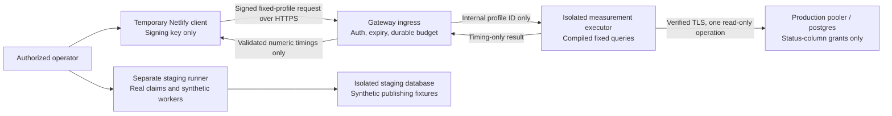

# Fixed-query diagnostic gateway — architecture for review

**Design only, 11 October 2026. No deployment or production connection authorized.**
The existing `sw_diag_ro_20261011_0a5570fb` role stays NOLOGIN with no password.
No production credentials will be supplied to a temporary Netlify project.
This proposal changes no scheduler, API, database security metadata or infrastructure.

## Recommended architecture

Use an HTTPS measurement service in an isolated container in an existing trusted
infrastructure account. Its database executor holds a **new, separately reviewed**
short-lived least-privilege credential. The Netlify client holds only a temporary
request-signing key and knows the gateway URL. It has no SQL client, Prisma engine,
production database URL, Supabase service-role key or publishing code.



The production gateway and staging runner have different deployments, identities,
secrets, networks and artifacts. A request cannot switch environments. Production
workload sizes, SQL, database hosts, connection parameters, timestamps, row IDs,
callback URLs, platform strings and worker endpoints are not input parameters.

The gateway is an application-level capability boundary, not a general PostgreSQL
wire-protocol proxy. Expose one POST endpoint, `/v1/measure`, whose accepted body is
exactly `{"profile":"<approved-profile>"}`. A signed run manifest controls which
profiles exist, which sample number/platform is next, destination, query hashes,
budgets, start/expiry time and region. Changing the manifest requires the operator;
there is no HTTP administration or configuration endpoint.

### Placement and measurement accuracy

Prefer a small isolated container in a user-controlled trusted account in
**us-east-2** for the initial run: this approximates the current Netlify function's
network path to the eu-central-1 production pooler. It must not share the application
runtime or import its publishing worker bundle. Availability of such hosting has
not been verified; provisioning remains a review prerequisite.

A second, separately approved run in eu-central-1 can assess whether proximity
reduces latency. Do not relocate Showwork's existing functions. Location alone does
not reproduce Netlify's routing, CPU or cold-start behavior, so identify executor
region, runtime, driver versions and topology on every result.

Netlify invokes the gateway to measure its own client cold/warm behavior, but HTTP
transit to the gateway is measured separately. **Do not treat total gateway HTTP
time as the scheduler's direct database time.** Report gateway-to-database timing,
Netlify-to-gateway timing and Netlify initialization separately. Combining staging
results with those measurements produces an estimate, not an actual production
write-throughput measurement.

## Predefined measurement profiles

Initial production run: at most 60 signed requests over at most two hours, spread
out sequentially, with no automatic retries. Each request performs one bounded
profile. The limit is global, not per instance or client.

| Profile | Fixed work | Limit per run | Result and interpretation |
| --- | --- | ---: | --- |
| `transport` | Resolve the pinned host; TCP connect; PostgreSQL SSLRequest; verified TLS handshake; close before startup/authentication | 10 | DNS, TCP and TLS durations; no SQL or credentials transmitted |
| `fresh-connection` | New executor/Prisma engine and client; explicit connect; fixed read-only transaction containing SELECT 1; close client | 10 | Executor initialization, Prisma connect, first transaction and cleanup; connect includes authentication/pooler effects, not a separately proven auth duration |
| `warm-roundtrip` | Existing initialized connection; fixed SELECT 1 inside READ ONLY transaction | 10 | Statement roundtrip and separately timed BEGIN, setup and COMMIT; no table access |
| `warm-transaction` | Same fixed setup/SELECT 1/COMMIT sequence used by the scheduler adapter, on a warm client | 10 | Full transaction, local acquisition wait, setup and cleanup timing; compare to warm-roundtrip without attributing differences solely to PostgreSQL |
| `scheduler-select-plan` | One fixed EXPLAIN ANALYZE SELECT for a server-selected platform, query family and time cutoff | 20 | Server planning/execution duration and client statement/transaction duration; no rows or full plan returned |

For `warm-roundtrip`, separate setup timing from the SELECT roundtrip; the
`warm-transaction` profile includes Prisma's scheduler-style interactive-transaction
wrapper and its configured setup commands. Keep their differing setup sequences
visible in the manifest. Their difference is observational, not an exact decomposition
of network and transaction cost.

For the 20 plan samples, run two rounds of five admission-selector queries and two
rounds of five stale-selector queries, rotating the first platform. Instagram,
TikTok, Facebook, LinkedIn and X each receive four samples. This is a diagnostic
sampling policy, not a publishing scheduler or database claim.

All queries use the existing production pooler mode and the same Node/Prisma
versions as Showwork. The gateway initially permits **one** active database operation
across the entire service. It deliberately does not attempt three-way production
concurrency or pressure-test the production five-connection configuration. A second
persistent connection is never created during fresh-connection profiles: close the
warm client first and rebuild it afterward under the same single-operation lease.
Production role connection limit is one; gateway process count is one, autoscaling
disabled. A role limit is defense in depth, not a substitute for the global gate.

### Exact SQL scope

Compile an immutable map of SQL templates; never accept SQL text, expressions,
identifiers, limits or parameters from the caller. Query-map/version hashes are
reviewed before an artifact can be connected. No general-purpose query method is
exposed to ingress. No prefix/regex-based SQL authorization is used.

The admission selector mirrors `lib/publishing/batchClaims.ts` candidate eligibility:
fixed platform/status, approval APPROVED, not an AI draft, server-derived UTC due
time, TikTok accepted-operation recovery predicate and 16-minute stale cutoff,
ORDER BY postDate/id, LIMIT 20. Use five literal platform variants, fully qualified
schema/type names, no joins to customer/account tables. Production samples omit the
per-run excluded IDs because there are no real claims; this limitation is explicit.

The stale selector mirrors the stale-candidate WHERE/ORDER BY predicates and
LIMIT 100, including TikTok's exclusion of accepted publishing IDs. Both selectors
omit every UPDATE CTE, lease mutation, row-lock clause and provider dispatch.

Illustrative fixed admission template (Instagram; not executable provisioning):

```sql
EXPLAIN (ANALYZE, FORMAT JSON, TIMING OFF, SUMMARY ON)
SELECT p."id", p."updatedAt"
FROM public."CalendarPost" AS p
WHERE p."platform" = 'INSTAGRAM'::public."SocialPlatform"
  AND p."instagramPublishStatus" = 'SCHEDULED'
  AND p."approvalStatus" = 'APPROVED'
  AND NOT p."isAiDraft"
  AND p."postDate" <= $1::timestamp
ORDER BY p."postDate", p."id"
LIMIT 20;
```

`$1` comes only from the executor's UTC clock, matching the scheduler's timestamp
semantics. The complete ten platform/query-family templates, their parameter
types and the read-only setup statements must be supplied in the implementation
review. No data-modifying EXPLAIN, standalone ANALYZE, VACUUM, catalog query,
SECURITY DEFINER call, SELECT FOR UPDATE/SHARE, advisory lock, notification,
large-object routine or user-defined function is a permitted measurement.

EXPLAIN ANALYZE executes its SELECT and has profiling overhead. TIMING OFF avoids
per-node timing overhead while retaining total execution timing; it does not make
instrumentation free. A LIMIT bounds returned/explained candidates, not necessarily
rows scanned. Query timeout and a staging review of production-equivalent indexes
remain mandatory. No production indexes/statistics are changed for this diagnostic.

## Security boundaries and required permissions

| Component | Permitted access | Explicit exclusions |
| --- | --- | --- |
| Operator | Prepare/review signed manifest; later authorize provisioning, teardown and a specific measurement window | No implicit authority to deploy Showwork publishing changes |
| Netlify client | Sign fixed-profile requests and collect timings | No database credential, arbitrary target URL, SQL, provider secret, worker invocation or scheduled trigger |
| Gateway ingress | Verify signature, reserve global budgets, select approved profile, return output allowlist | No database secret; no raw query API or artifact-upload/config API |
| Executor | Exact compiled measurement map; pinned pooler/postgres; new status-column credential in trusted secret storage | No internet/API/provider egress, application admin secret, customer content query, production DML or worker bundle |
| Staging runner | Real claims, leases, cleanup and fixture-only worker transitions in staging | No production route, secret, network path, real providers or production data dump |

### Database permission proposal — not applied

Create a new dedicated account only after architecture and effective-permissions
review. Do not activate or reuse the existing disabled role. No production/admin
credential is transferred to the gateway or Netlify. Administrative access, if later
approved, is used only for local security provisioning and revocation.

Grant CONNECT on postgres, USAGE on public and column SELECT on exactly:
`id`, `platform`, `postDate`, `approvalStatus`, `isAiDraft`,
`instagramPublishStatus`, `tikTokPublishStatus`, `publishStatus`, `tikTokPublishId`,
`publishWorkerStartedAt`, `updatedAt`.
No whole-table SELECT, content/error/media/account/token columns, writes, sequence
access, memberships, grant options, ownership, schema CREATE or elevated attributes.
Keep row_security on and no BYPASSRLS. CalendarPost currently has no RLS; this grants
status-column access across tenants internally. It is not a tenant-limited role.

Use READ ONLY as the first transaction declaration, plus default read-only, 2-second
statement timeout, 250-ms lock timeout and 5-second idle-in-transaction timeout.
Use trusted built-in operators/types only. Before activation, re-audit effective
permissions, RLS policies, type/cast behavior and query dependencies. Unexpected
permission drift or row policies that call privileged routines fails review.

**Inherited PUBLIC limitations remain:** this new raw PostgreSQL credential would
still inherit catalogs, temporary objects, certain built-ins and cross-database
CONNECT unless global permissions changed. The design does not claim otherwise.
The enforcement boundary is the fixed-query service, which never grants callers
possession of that credential or a raw PostgreSQL channel. These extra capabilities
are unavailable through its API. Compromise of the trusted executor or theft of its
credential remains a residual risk. If resistance to a fully compromised executor
is required, this architecture needs an independently enforcing SQL firewall or an
isolated read-only replica; application allowlisting alone is insufficient. Neither
is silently assumed available. Do not revoke production-wide PUBLIC permissions.

### Authentication, budgets and expiry

- HTTPS with ordinary certificate/hostname validation; no TLS-disable flags.
- Ed25519 signed requests using a fresh per-run client key. The gateway keeps only
  the public verification key; no shared database credential or reusable admin token.
- Signature covers protocol version, run ID, method, exact path, SHA-256 body hash,
  UTC issue time, unique nonce and configured audience. Accept at most 30 seconds
  of clock skew, enforce manifest not-before/expiry, and reserve nonces atomically
  before execution. Authentication and validation happen before any database access.
- Private signing key is server-side only, short-lived and restricted to this run.
  Client compromise can consume the small measurement budget but cannot expand it.
  The Netlify client endpoint itself requires operator authentication and the same
  absolute expiry; no public trigger, cron or automatic retry is configured.
- POST only, Content-Type application/json, body at most 1 KiB. Reject duplicate
  keys, unknown fields, non-enumerated profiles, compression and unexpected headers
  used to select destinations. No CORS access or browser-client bundle.
- Persistent, atomic counter/nonce/active-operation state in a gateway-local durable
  ledger, separate from production. One service replica, one executor lease; restart
  never resets counters. Missing/corrupt ledger fails closed. Failed/authenticated
  attempts consume budget; rejected unauthenticated traffic cannot open DB sessions.
- At most 6 authenticated requests/minute, 60 total, with the profile quotas above.
  Busy request returns 429 immediately; no request queue, background loop or retry.
  Edge limits: 30 attempts/minute per source and 120/minute globally, plus connection
  and body limits. These are proposed caps requiring hosting support verification.
- Expiry is absolute and at most two hours. On expiry, reject new work, cancel active
  work, close database clients and stop the executor. A separately provisioned trusted
  cleanup timer disables/revokes the credential and deletes the temporary artifacts;
  password expiry alone does not terminate existing database sessions. The cleanup
  timer runs in the existing trusted control plane, separately from ingress/executor;
  no CREATEROLE/admin credential is granted to either measurement component. Its
  role-specific revocation authority and guaranteed scheduling require review.
- Emergency stop: disable run at ingress, close executor and sessions, revoke only
  diagnostic access. Stop automatically on any permission mismatch or two consecutive
  measurement timeouts/errors. No retries that could conceal pooler pressure.

### Timeouts and result filtering

Proposed limits: DNS/TCP/TLS/connect combined at most 4 seconds; each statement at
most 2 seconds; transaction at most 3 seconds; executor work at most 10 seconds;
forced child-process termination/connection destruction by 12 seconds; gateway
response deadline 15 seconds; Netlify client outbound timeout 18 seconds and total
handler deadline 22 seconds. Do not start a query if the remaining budget is below
its timeout plus cleanup reserve. Parent kill/cleanup must be independent of Prisma
promise cancellation; no indefinite engine startup or disconnect wait.

A timeout is a failed measurement, not a slower successful sample. Destroy the
client instead of returning an uncertain transaction to the warm pool. Reject new
work until executor termination is confirmed. Verify all deadlines in staging;
this proposal is not measured runtime evidence or proof of Netlify's 30-second margin.

Return only a small typed allowlist: profile/version/run-sample IDs, coarse runtime
region, durations, instance-first-invocation flag and a fixed error enum. No customer
rows/IDs, TikTok IDs, counts of due posts, SQL text, plan trees, filters, statistics
values, headers, connection URLs, passwords, source code or stack traces. Parse plan
JSON inside the executor and extract only finite nonnegative Planning Time and
Execution Time values. Unexpected shapes fail closed. Response size at most 4 KiB,
Cache-Control no-store. Logs contain only profile/sample identifiers and timing/error
enums; disable query/APM tracing, payload capture and credential-bearing crash dumps.

Production SELECTs can acquire ordinary read locks, consume CPU/I/O and warm caches;
read-only means no deliberate data changes, not zero impact or zero storage activity.
Keep timeout, budget, sequential execution and stop thresholds even for SELECTs.

### TLS and secrets

Use the already verified official Supabase Root 2021 CA at
`scripts/diagnostics/prod-ca-2021.crt`, with pinned SHA-256 fingerprint from the final
permissions report, validity checks and strict hostname validation. Match Prisma's
strict certificate options to the production pooler; never downgrade verification.
Do not silently change global Supabase SSL enforcement.

Executor secret comes from trusted hosting secret storage, never command arguments,
build variables, image layers, source, diagnostics output or temporary Netlify.
Ingress has no secret-mount permission. Pin the database host, port, database name
and account in immutable configuration. Permit executor network egress only to the
approved pooler/DNS resolver as needed; reject all API/provider destinations. Resolve
and review firewall/DNS requirements before deployment. TLS authenticates the
hostname even when pooler IPs rotate.

## Measurement interpretation and staging assessment

- DNS/TCP/TLS are directly instrumented transport stages. They use a separate
  credential-free probe, not a decomposition of Prisma's same connection attempt.
- Prisma connect time includes engine startup where relevant, authentication and
  pooler negotiation; acquire time can include client or backend waits. On transaction
  pooling, backend acquisition may appear at BEGIN/first statement instead of connect.
- Warm SELECT 1 estimates statement-roundtrip overhead. It is not pure network RTT.
  Client statement time minus server execution time is a residual including transport,
  pooler waiting and client/protocol overhead; report it without claiming exact attribution.
- Explicit transaction-control timings expose added roundtrips/setup cost. Disable
  unsupported prepared statements and preserve the current pgbouncer=true behavior.
- Read-only candidate/stale plans cannot measure lock contention, WAL, trigger/index
  maintenance, real claims or commit durability for writes. Do not infer those from SELECT.
- Gateway service initialization and Netlify client first-invocation timing are different
  cold starts. First invocation is only a proxy: use platform runtime init telemetry
  where available, client-observed total duration and separately measured module/handler
  timing. Do not manufacture cold starts or infer init duration by subtracting unrelated clocks.

Use a separate PostgreSQL **17.6** staging instance (matching production), production-
equivalent enums/indexes/constraints/triggers needed for claims, and synthetic fixtures
only. Reconstruct required structure from reviewed migrations; never copy secrets
  or production records. Replace any integration-trigger side effects with fixture-only
  behavior and deny provider/network egress. No production dump, provider credentials
  or external provider calls. Set the
scheduler client pool to five and test gates of one, two and three operations with
real SQL; preserve existing batch claims and exact lease/worker guards. Test overlap
between two scheduler invocations and fixture worker updates to expose aggregate
pressure beyond a single gate. Use independently controlled network-delay/jitter
profiles calibrated from approved production measurements, clearly labeled injected.

Run balanced and skewed 10/25/50/100/250 workloads; continuous arrivals on all five
platforms; rollback/ambiguous-commit, locked-oldest-row, stale cleanup, accepted TikTok
recovery, dispatch-failure cleanup and approval/future/AI exclusions. Verify exact
claimed IDs, no dispatch before commit, no duplicate synthetic worker transitions,
all platforms progress, and deferred rows are served on later ticks without starvation.
Report p50/p95/max, raw sample size and timeouts; small production samples support
observations, not a robust tail guarantee. Staging results must document schema and
workload differences from production.

Run the actual scheduler artifact with the staging database from a credential-free-
production Netlify diagnostic to verify cold/warm function duration, cleanup margin
and publishing delay. Only **staging** credentials may be supplied for that separate
approved test, under the same expiry/authentication safeguards. Synthetic workers
remain internal/no-op; no Showwork publishing endpoint is callable. Netlify region,
engine startup and driver versions must match the intended deployment. Production
performance estimates remain estimates even after this test.

## Deployment plan and review gates

1. Review this architecture, hosting/region choice, one-operation production cap,
   two-hour/60-request budget, output schema and residual executor-credential risk.
   No infrastructure or database role changes in this step.
2. Implement ingress/executor/client as separate minimal packages with immutable
   query maps and no scheduler/providers in the production gateway. Supply exact
   SQL, grants, expiry/teardown scripts, artifact manifests and redacted configuration.
3. Validate locally and on isolated staging: auth/signature tampering, replay/expiry,
   duplicate/unknown input, output-leak traps, permission drift, restart-safe budgets,
   simultaneous callers, query timeouts, executor crash/cancellation, TLS failures,
   egress restrictions, cold/warm timing and teardown. Audit archives/dependencies.
4. Obtain explicit approval for staging deployment. Exercise full scheduler contention
   tests there. Gate any production review on those safety checks passing.
5. Supply final staging results, effective-permissions report for the **new** gateway
   role, verified CA/config, exact trusted hosting destination, secret-access policy,
   execution/query budget and cleanup schedule for separate production connection approval.
   No activation or production-connected testing happens before that approval.
6. After that later approval only, provision a fresh short-lived credential in trusted
   gateway secret storage and activate the reviewed window. Client gets only its
   signing key. Run sequential approved samples, stop on thresholds, collect timings.
7. Revoke/terminate only gateway sessions; remove its role/grants, secrets, signing
   key, ingress route/container/client project and durable nonce ledger. Verify teardown
   and preserve only sanitized timings. Existing disabled role remains unactivated.
8. Produce a publishing release GO/NO-GO based on staging correctness plus explicitly
   qualified production timing, estimated peak delays and measured function margin.
   Publishing deployment still requires separate authorization.

**Current decision:** suitable architecture to review and implement offline;
**NO-GO for gateway production activation or publishing deployment.** No production
latency or throughput result is claimed by this design.

## Primary technical references

- [Supabase connection modes and transaction-pooler limitations](https://supabase.com/docs/guides/database/connecting-to-postgres)
- [Supabase pooling and connection limits](https://supabase.com/docs/guides/database/connecting-to-postgres/pooling-and-limits)
- [Supabase SSL verification](https://supabase.com/docs/guides/platform/ssl-enforcement)
- [PostgreSQL EXPLAIN execution and timing overhead](https://www.postgresql.org/docs/17/sql-explain.html)
- [PostgreSQL READ ONLY transaction behavior](https://www.postgresql.org/docs/17/sql-set-transaction.html)
- [PostgreSQL additive PUBLIC privileges](https://www.postgresql.org/docs/17/ddl-priv.html)

Related local evidence: `publishing-diagnostic-final-permissions.md`,
`publishing-phase2-assessment.md`, `lib/publishing/batchClaims.ts`.
